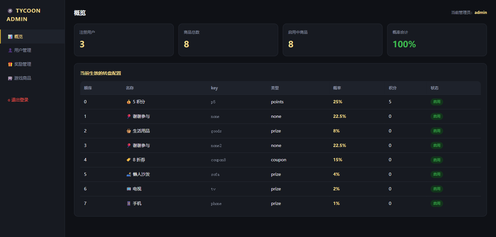
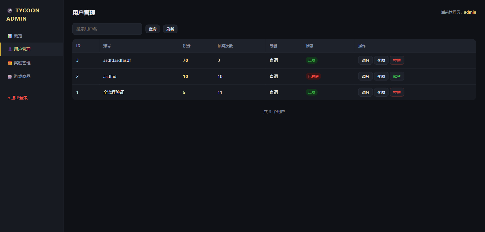
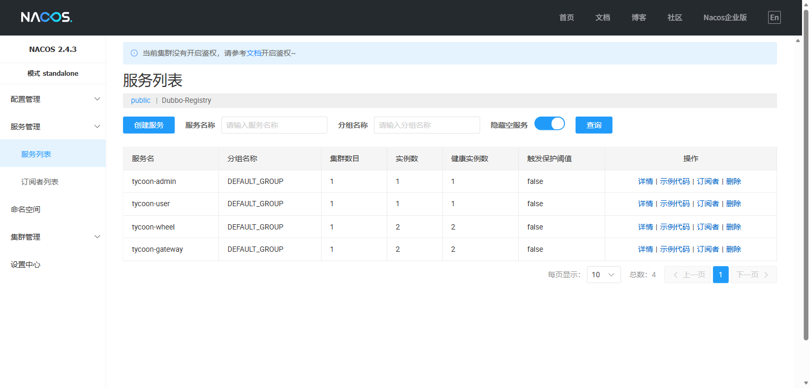
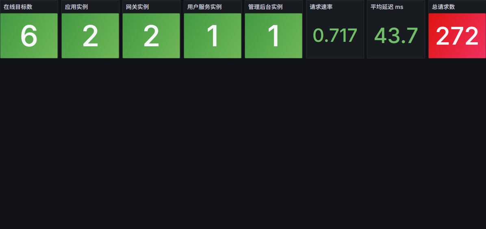
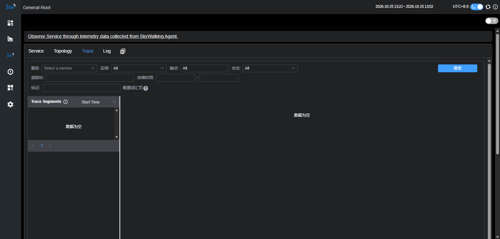
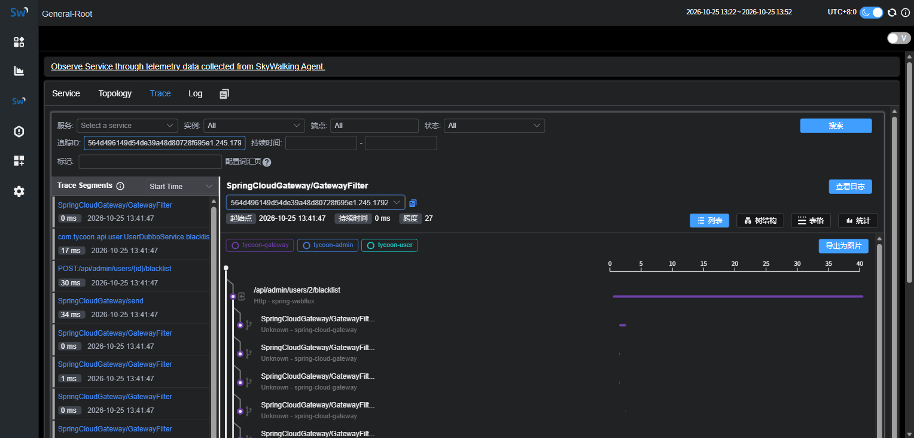
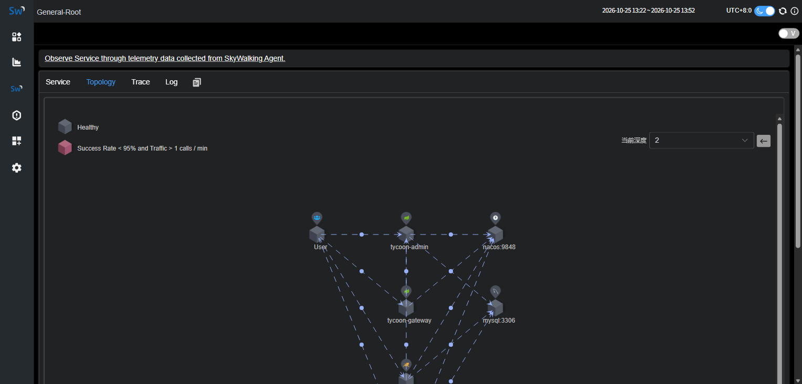
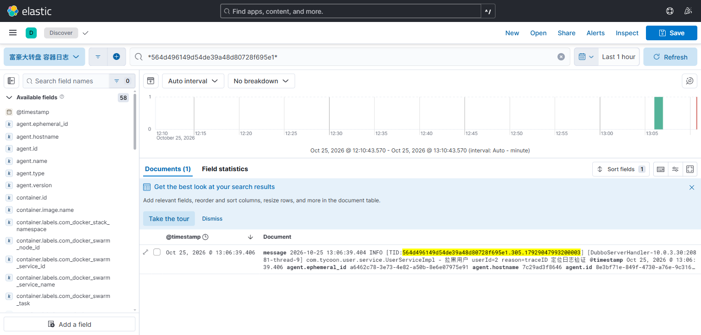

# 界面截图

## 玩家端

### 游戏界面

登录后看到的转盘。9 个扇区对应后台配置的 9 个商品，
下方是抽奖按钮、剩余积分、抽奖次数。

## 管理后台

### 概览

注册用户数、商品总数、启用数、**概率合计**（≠100% 会标红）。
左侧四个菜单：概览 / 用户管理 / 奖励管理 / 游戏商品。

### 用户管理

可以搜索用户、调整积分（正负均可）、拉黑/解禁。

## 注册中心

### Nacos 服务列表

`public` 命名空间里只有 4 个应用名，没有 `providers:com.xxx::` 这类接口级条目
（Dubbo 的接口级注册被隔离到独立的 `dubbo` 命名空间）。

## 监控

### Grafana 大盘

在线目标数、各服务实例数、请求速率、平均延迟、总请求数。
数据源是 Prometheus，包含 5 个 job（app / gateway / user / admin / mysql）。

## 链路追踪

### SkyWalking Trace 标签页

路径：服务 → `Services/tab/2`。可以按服务、实例、端点、**追踪ID** 过滤。

### 按 traceID 查链路

在「追踪ID」里粘贴日志中的 TID，能看到跨服务的完整调用链：
gateway → admin → Dubbo → user → MySQL，瀑布图展示每个 span 的耗时。

### 拓扑图

服务依赖关系。业务链路是正确的：
`gateway → wheel`（用户请求）、`gateway → admin`、`wheel → admin`（Dubbo 拉配置）、`admin → user`（Dubbo 用户操作）。

> 图中还有 `User → 各服务` 的虚线，那是 Prometheus 采集 `/actuator/prometheus` 产生的，
> 不是用户流量。详见 [压测报告](LOAD-TEST.md)。

## 日志

### Kibana 按 traceID 定位日志

在 Kibana Discover 里用 KQL 通配符 `*traceId*` 检索，
精确命中带该 traceId 的日志行，并且高亮显示。

这样就实现了 **链路 ↔ 日志** 的双向定位：

1. 看到报错日志 → 取 TID → SkyWalking 查完整链路
2. 看到慢链路 → 取 traceId → Kibana 查对应日志
